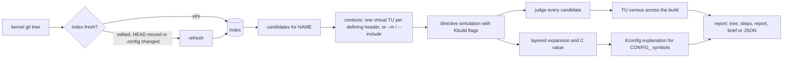

# kmx

kmx is a config-aware explorer for Linux kernel macros.

Much of the kernel is written in macros, and the preprocessor erases them before
anything else sees the code. A name such as `PAGE_SIZE`, `HZ` or `pr_fmt` has
many definitions across architectures, headers and source files. The one that
wins depends on `.config`, the compiler, the include path and the translation
unit. kmx answers the question directly. For a macro, an enum constant or a
`CONFIG_` symbol it shows:

- the definition that the current configuration selects, and its value;
- the expansion peeled layer by layer, like an onion: for each nested macro its
  definition, the `#if` chain that selected it, and its intermediate result and
  value, down to the Kconfig decision behind each `CONFIG_` symbol;
- for a macro that names itself, such as `#define phys_to_virt phys_to_virt`,
  the C function or enum constant behind the name, with the macros in the
  function body peeled the same way;
- when the answer differs between translation units, how the TUs of the
  current build divide between the variants.

The first line is the conclusion: the value, or the expansion pushed as far as
it goes. When the name leads to a C function whose body is a single `return`,
the conclusion is that result in terms of the parameters, for example
`phys_to_virt(address) = (void *)((unsigned long)address + (unsigned long)page_offset_base)`
on x86. Every node of the tree below leads the same way with its own result,
`call = result`, followed by the definition, its location and the conditions
that selected it, so the tree reads from the answer down to the reasons.

Results are cleaned up only by rewrites that hold for every C expression:

- Parentheses are dropped only where the C grammar proves them redundant.
  `(x) - y` keeps its parentheses whenever `x` could be a type name, because
  `(x)` would then be a cast. Function parameters are known variables, and
  inside a statement expression `({ ... })` its declarations prove which names
  are types and which are variables.
- Operations on integer constants are folded into one literal of the same type:
  `1UL << ((39) - 1)` becomes `0x4000000000UL`. A result of bit operations or of
  hexadecimal operands is written in hexadecimal. Nothing is folded when the
  operation is undefined or implementation-defined, such as signed overflow, a
  shift by the width of the type, or a right shift of a negative value.
- A cast repeated on its own result is written once:
  `(unsigned long)(unsigned long)address` becomes `(unsigned long)address`, as
  in riscv64's `virt_to_phys`, whose `__pa()` casts what it already cast.
  Converting a value to the type it already has changes nothing. Only basic
  types and pointers to them qualify: a typedef name could be a variable, and
  `typeof` of a variably modified type evaluates its operand.
- Statements without effect are removed from statement expressions: `(void)`
  applied to a constant or to a `sizeof` whose operand cannot be a variable
  length array, and empty statements. With `CONFIG_DEBUG_VM` off,
  `({ VM_BUG_ON(x); y; })` reads `({ y; })`. The last statement is the value
  and stays; `({ y; })` is not reduced to `y`, because the two differ as
  lvalues and in constant expressions.

C code longer than 80 columns, or than the terminal when it is narrower, is
broken in kernel style: eight-column indents, the statements of a statement
expression on their own lines, `?` and `:` leading their lines, arguments packed
and aligned after the opening parenthesis, and the result moved below the `=`
when it fits there. Only whitespace changes; the tokens stay the same.
Conclusions longer than 400 characters are cut unless `--all` is given.

By default only the active chain is shown. `--all`, or `--candidates N` for N
per reason, adds every other candidate, grouped by the reason it lost.

```
$ kmx ~/src/linux PAGE_SIZE
PAGE_SIZE = 4096 (0x1000, 4 KiB)  unsigned long

  tree     /home/me/src/linux
  context  6.12.112  7aba70ab2e8d  x86_64  gcc 16.0.1
           virtual TU: <asm/page_types.h> (kbuild flags taken from linux/init/.main.o.cmd)
           predefined macros: queried from gcc
  TU  defined inside 1 source file(s), so the value depends on the TU

PAGE_SIZE = 4096 (0x1000, 4 KiB)
│ #define PAGE_SIZE (_AC(1,UL) << PAGE_SHIFT)
│                                           linux/arch/x86/include/asm/page_types.h:11
├─ _AC(1, UL) = 1
│  │ #define _AC(X,Y) __AC(X,Y)             linux/include/uapi/linux/const.h:21
│  │ ✓ #else  linux/include/uapi/linux/const.h:19
│  │   line 16: #ifdef __ASSEMBLY__ -> false (__ASSEMBLY__ undefined)
│  └─ __AC(1, UL) = 1
│       #define __AC(X,Y) (X##Y)            linux/include/uapi/linux/const.h:20
│       ✓ #else  linux/include/uapi/linux/const.h:19
│         line 16: #ifdef __ASSEMBLY__ -> false (__ASSEMBLY__ undefined)
└─ PAGE_SHIFT = 12 (0xc)
   │ #define PAGE_SHIFT CONFIG_PAGE_SHIFT   linux/arch/x86/include/asm/page_types.h:10
   └─ CONFIG_PAGE_SHIFT = 12 (0xc)
        #define CONFIG_PAGE_SHIFT 12        linux/include/generated/autoconf.h:24
        (.config:822 CONFIG_PAGE_SHIFT=12)
        ✓ Kconfig default 12 if PAGE_SIZE_4KB  [y: PAGE_SIZE_4KB=y]  linux/arch/Kconfig:1241

values across 3357 TUs of the current build: 3278 TUs get linux/arch/x86/include/asm/page_types.h:11 = 4096 (0x1000, 4 KiB); 1 other variant (--all)
```

kmx never modifies the kernel tree or the build directory. Its index and caches
live in a separate data directory.

## Requirements

- A Linux host. The kernel under analysis must target x86_64, arm64 or riscv64.
- Rust 1.91 or newer to build.
- `git`, because the tree argument must be a kernel git work tree.
- A configured tree: `.config` in the tree, or in the Kbuild output directory
  passed with `-O`.

Optional, but they make the answers exact:

- The compiler that builds the kernel, with the major version recorded in
  `.config`, or in `include/generated/compile.h` when an older `.config` lacks
  it (`gcc`, `gcc-N`, a cross `aarch64-linux-gnu-gcc`, or `clang`).
  kmx runs it in preprocess-only mode to read its predefined macros and its
  `__has_attribute`/`__has_builtin` answers for the real kernel flags. Without
  it, kmx falls back to built-in tables.
- A completed build (`vmlinux.a`, or the `built-in.a`/`built-in.o` files of
  older kernels, `modules.order`, `.o.cmd` files). kmx then
  takes each file's real compile flags from Kbuild and can enumerate variants
  across the TUs of that build. Without a build, it synthesizes `autoconf.h`
  from `.config` and uses a representative set of flags. When the compiler
  header directory recorded there (`-isystem`) does not exist on this machine,
  for example because the tree was built in a container, kmx uses the include
  directory of the compiler it found (`-print-file-name=include`) and shows
  both paths in the context.

## Installing

```
./install.sh
./install.sh --user
./install.sh --uninstall
```

`install.sh` builds kmx with cargo and installs it, together with its Tab
completion scripts, so that `kmx` runs from any directory like any other
command. It is plain POSIX sh that needs only `cargo` and the standard `install`
tool, so it behaves the same on Arch, Debian, Ubuntu, Fedora, RHEL, Void and
other distributions. The default prefix is `/usr/local`, which every
distribution keeps on `PATH` and leaves to the administrator. The build always
runs as the invoking user, and only the copy into a directory that the user
cannot write asks for `sudo` or `doas`. `--user` installs under `~/.local`
instead, without root. `--prefix DIR` and `--destdir DIR` serve packaging, and
`--no-build` installs an existing `target/release/kmx`.

| Installed file | Purpose |
|---|---|
| `PREFIX/bin/kmx` | The program. |
| `PREFIX/share/bash-completion/completions/kmx` | bash completion, loaded by bash-completion. |
| `PREFIX/share/zsh/site-functions/_kmx` | zsh completion; `/usr/local/share/zsh/site-functions` is on zsh's default `fpath`. |
| `PREFIX/share/fish/vendor_completions.d/kmx.fish` | fish completion. |
| `PREFIX/share/doc/kmx/` | This README and the license. |

Building needs Rust 1.91 or newer; where the distribution ships an older
toolchain, install one with rustup. The script refuses to run under `sudo`,
because the build would leave root-owned files in the checkout. `--uninstall`
removes the installed files and leaves the indexes in the data directory.

Reinstalling, or building a changed kmx, keeps the existing indexes. The new
binary replaces the old one with an atomic rename, so a kmx that is running at
that moment finishes undisturbed. Memoized results and analysis caches are
keyed by a hash of the kmx sources, not by the binary's path or timestamp: the
same sources installed twice share them, and changed sources compute fresh
results while the caches of the previous build stay until a newer build
replaces them. An index written in an older format is rebuilt on first use, and
fields that older kmx versions did not record, such as the content hash, are
filled in when the index is next read.

## Building

```
cargo build --release
```

The binary is `target/release/kmx`.

## Usage

```
kmx <TREE> [OPTIONS] [COMMAND] [ARGS]...
kmx <TREE> <NAME>...                         same as: kmx <TREE> show <NAME>...
kmx ls | rm <ID|TREE>... | prune | inspect <ID|TREE>...
kmx --completions zsh|bash|fish
```

`TREE` comes first and is mandatory for every analysis. It must be the top
level of a Linux kernel git work tree; kmx refuses a subdirectory, a path that
is not a git work tree, and a tree that contains nested git repositories or
submodules. kmx never guesses the tree from the current directory. The
management commands `ls`, `rm`, `prune` and `inspect` take no `TREE`; a tree
directory that happens to have one of these names is written as `./ls`.

`TREE` can also be the ID that `kmx ls` prints, or any unique prefix of it with
at least four hex digits: `kmx fc789d5303c8 PAGE_SIZE` analyses the tree indexed
under that ID, with its recorded build directory, so `-O` is not needed. An
existing path with the same spelling wins over an ID.

An ID is 16 hex digits: the xxh3 hash of the source and build directory paths.
Each index directory records the paths it belongs to, so two trees can never
share one: when the hash names a directory another tree holds, kmx takes the
hash with the next seed instead. IDs are shown with their first 12 digits, or
with as many more as it takes to tell them apart from every other ID.

kmx recognizes a kernel by content, not by file names. The top-level Makefile
must start with the kernel version and define `KERNELRELEASE`, `KERNELVERSION`
and the `vmlinux` target; the Kconfig main menu must be `Linux/...`;
`init/main.c` must define `start_kernel()`; `include/linux/kconfig.h` must
define `IS_ENABLED`; and kbuild's `scripts/Kbuild.include` and
`scripts/kconfig/conf.c` must exist. When the index is built, these files must
also be tracked by git. A U-Boot, barebox or Zephyr tree, a partial copy, or a
directory that only imitates the layout is refused with the list of what does
not match.

```
kmx ~/src/linux PAGE_SIZE                     tree with .config in place
kmx ~/src/linux -O ~/build/arm64 PAGE_SIZE    out-of-tree build (make O=...)
kmx ~/src/linux PAGE_SIZE HZ THREAD_SIZE      several names at once
kmx ~/src/linux FIX_APIC_BASE                 enum constant
kmx ~/src/linux CONFIG_HZ                     Kconfig symbol
kmx ~/src/linux expand 'ALIGN(13, 8)'
kmx ~/src/linux line mm/slub.c:1000
kmx ~/src/linux list 'SZ_*K' --resolve
kmx ~/src/linux grep -w PAGE_SIZE             every definition, one line each, with status
kmx ~/src/linux uses CONFIG_PAGE_SHIFT        definitions whose body uses a name
kmx ~/src/linux HZ --set HZ_250=y             what-if
kmx ls                                        every indexed tree, as in docker images
kmx rm 2c2efcc13985                           delete one index, by ID prefix or tree path
```

### Commands

| Command | Purpose |
|---|---|
| `show NAME...` | Resolve macros, enum constants or `CONFIG_` symbols. The default command. |
| `expand TEXT` | Expand arbitrary text, for example a macro call with arguments. Headers that define the macros used are included automatically. |
| `line FILE:LINE` | Expand every macro on one source line, in that file's own context up to that line. |
| `list [PATTERN] [--regex] [--resolve]` | List names matching a glob (or a regex) with their definition counts. `--resolve` adds the current value and the active site. |
| `grep PATTERN [-w] [-g]` | Print every definition of the matching names, one line each, with its status in this configuration: `path:line: definition  [status]`. PATTERN is a regular expression matched anywhere in a name, as in rg; `-w` matches whole names and `-g` takes a glob. |
| `uses NAME` | Print the definitions whose body uses NAME, with their status in this configuration. |
| `dump [--format tsv\|json]` | Dump every macro active in a context. Needs `--in` or `--include`. |
| `index` | Rebuild this tree's index from scratch. |
| `ls` | List every indexed tree: ID, kernel, commit, content hash, architecture, state, age, size and path. No `TREE`. |
| `rm ID\|TREE...` | Delete the index of these trees, named by an ID prefix (from `ls`) or a tree path. No `TREE`. |
| `prune` | Delete the indexes whose tree or build directory is gone, that are no longer a kernel tree, or that are incomplete. No `TREE`. |
| `inspect ID\|TREE...` | Show everything recorded about these indexes and their current state. No `TREE`. |

### Options

| Option | Meaning |
|---|---|
| `-O, --build-dir DIR` | Kbuild output directory (`O=`) holding `.config` and generated headers. |
| `--norefresh` | Do not update the index: when files were edited, HEAD moved, the kernel version changed or `.config` changed, report it and exit with status 3 (alias `--no-refresh`). |
| `--cc SPEC` | Override the compiler identity, for example `gcc-13.2` or `clang-19`. |
| `--set SYM=VAL` | What-if: override a Kconfig symbol and re-evaluate everything with Kconfig rules. Repeatable. |
| `--in FILE[:LINE]` | Context: preprocess as part of this source file, optionally up to `LINE`. |
| `--include HEADER` | Context: a virtual TU that includes this header. Repeatable. |
| `--style tree\|steps\|report` | Output layout. `tree` is the default. |
| `--depth N` | Limit the depth of the expansion tree. |
| `--candidates N\|all\|none` | Also show losing candidates, N per reason group. `show`, `expand` and `line` print only the active chain by default; `grep` and `uses` default to 3. |
| `--all` | Show every candidate, every census variant and whole function bodies. |
| `--scope kernel\|all` | Which definitions count as candidates: the kernel proper for every architecture (default), or also `tools/`, `scripts/`, `Documentation/` and `usr/`. Definitions for other architectures stay listed as losing candidates, because `.config` fixes the architecture. |
| `-b, --brief` | Print only the conclusion: the first line of the tree output, cleaned up and wrapped the same way, one per name. |
| `--json` | JSON Lines: one object per result. Expansion nodes and arguments carry `refined`, the cleaned-up result, when it differs from the raw expansion. |
| `--vimgrep` | Print `grep`, `uses` and `list` results as `path:line:column:text`, for editor quickfix lists. |
| `--color auto\|always\|never` | `auto` colors only when stdout is a terminal and honors `NO_COLOR` and `CLICOLOR_FORCE`. |
| `--pager` | Page output through `$KMX_PAGER`, `$PAGER` or `less -FRX` when stdout is a terminal. |
| `--ascii` | Draw trees with ASCII instead of box-drawing characters. |
| `--no-census` | Do not enumerate per-TU variants of TU-dependent macros. |
| `--no-memo` | Ignore memoized results and do not store new ones. |
| `-j, --threads N` | Worker threads (default: all cores). |
| `-q, --quiet` | Suppress progress notices on stderr. |
| `--completions zsh\|bash\|fish` | Print a Tab-completion script for that shell. |

### Output

The default `tree` layout peels the subject like an onion, depth first. Each
node starts with its cleaned-up result and value, `call = result`; below come
the definition text with its site on the right, the `#if` chain that selected
it, and the arguments that expansion changed. A `CONFIG_` node adds the Kconfig
default or `select` that applied. Losing candidates appear only with `--all` or
`--candidates N`, grouped by the reason each one lost, except when nothing is
active: then the candidates are the answer and are always listed. For a
TU-dependent macro, one line says how many TUs of the build get the headline
value and how many other variants exist; `--all` lists every variant. `steps`
lists the rewrite steps in order; `report` prints summary, dependency and
candidate sections.

A macro that expands to its own name, such as `#define phys_to_virt
phys_to_virt`, stops there by the C rules, because the name is the C function or
enum constant of the same name. kmx continues into that entity. An enum constant
gives its value, and expressions that use it are evaluated with it. A function
is located in the files of the context, skipping definitions in inactive `#if`
branches; kmx shows its signature and body (20 lines, all with `--all`) and
peels every macro used in the body:

```
$ kmx ~/src/linux-4.6 phys_to_virt
phys_to_virt(x) = (void *)((unsigned long)(x - ({ memstart_addr; })) |
                           0xffffffc000000000UL)

  tree     /home/me/src/linux-4.6
  context  4.6.7  096998b11906  arm64  gcc 16.0.1
           virtual TU: <asm-generic/io.h> (kbuild flags taken from linux-4.6/init/.main.o.cmd)
           predefined macros: queried from aarch64-linux-gnu-gcc
           compiler headers: /usr/lib/gcc/aarch64-linux-gnu/16.1.0/include
             (the build's /usr/lib/gcc-cross/aarch64-linux-gnu/16/include is absent here)

phys_to_virt = phys_to_virt
│ (names itself: the C static inline function below applies)
│ #define phys_to_virt phys_to_virt         linux-4.6/arch/arm64/include/asm/memory.h:175
│ ✓ #ifndef __ASSEMBLY__  linux-4.6/arch/arm64/include/asm/memory.h:133  [__ASSEMBLY__=undefined]
└─ phys_to_virt(x) = (void *)((unsigned long)(x - ({ memstart_addr; })) |
   │                          0xffffffc000000000UL)
   │ static inline function                 linux-4.6/arch/arm64/include/asm/memory.h:176
   │ static inline void *phys_to_virt(phys_addr_t x)
   │ {
   │         return (void *)(__phys_to_virt(x));
   │ }
   └─ __phys_to_virt(x) =
      │         (unsigned long)(x - ({ memstart_addr; })) | 0xffffffc000000000UL
      │ #define __phys_to_virt(x)           linux-4.6/arch/arm64/include/asm/memory.h:94
      │         ((unsigned long)((x) - PHYS_OFFSET) | PAGE_OFFSET)
      ├─ PHYS_OFFSET = ({ memstart_addr; })
      │  │ #define PHYS_OFFSET              linux-4.6/arch/arm64/include/asm/memory.h:140
      │  │         ({ VM_BUG_ON(memstart_addr & 1); memstart_addr; })
      │  │ ✓ #ifndef __ASSEMBLY__  linux-4.6/arch/arm64/include/asm/memory.h:133  [__ASSEMBLY__=undefined]
      │  └─ VM_BUG_ON(memstart_addr & 1) =
      │     │         (void)sizeof((long)(memstart_addr & 1))
      │     │ #define VM_BUG_ON(cond) BUILD_BUG_ON_INVALID(cond)
   ...
```

`grep` and `uses` follow the same grouping as the candidate lists: the active
definition comes first, then up to three definitions per reason (`--candidates
N` and `--all` change this), and one summary line for the rest. With
`--vimgrep` every definition is printed.

```
$ kmx ~/src/linux grep -w HZ
tree  /home/me/src/linux
linux/include/asm-generic/param.h:8: # define HZ CONFIG_HZ  [active = 1000 (0x3e8), varies by TU]
linux/include/asm-generic/param.h:7: # undef HZ  [undefined later: #undef executed here]
linux/include/uapi/asm-generic/param.h:6: #define HZ 100  [undefined later: #undef at linux/include/asm-generic/param.h:7]
linux/include/linux/raid/pq.h:180: #undef HZ  [condition false: #ifndef __KERNEL__]
...
```

A report names the tree once, with its full path, on its `tree` line (and the
build directory on a `build` line for `-O`). Every other path then starts with
the tree directory's name, so `/home/me/src/linux/include/linux/kernel.h` reads
`linux/include/linux/kernel.h`, and build-directory files start with the build
directory's name. `grep`, `uses` and `list` print the same `tree` line first
when stdout is a terminal. `--vimgrep` keeps paths that start with `TREE`
exactly as given, so an editor can open every location from the current
directory, and JSON keeps paths relative to the tree, with the tree itself in
`context.tree`.

The context line separates the kernel release from the HEAD commit with U+F126
(``), the Nerd Font git glyph that powerlevel10k uses; `--ascii` writes
`@` instead.

Output is plain monochrome text when piped. On a terminal it uses the 16-color
ANSI palette, so it follows the terminal's color scheme.

Values are evaluated with C rules for LP64 targets: literal suffixes, the usual
arithmetic conversions, casts to kernel integer types, `sizeof` of basic types
and `typeof` casts. A value is shown in decimal and hexadecimal, plus a KiB,
MiB, GiB or TiB form when it is an exact multiple.

Candidate statuses:

| Status | Meaning |
|---|---|
| `active` | This definition wins in the context shown. |
| `what-if replaced` | The `.config` value of a generated definition that `--set` replaced. |
| `overridden` | Executed, then redefined later in the same context. |
| `undefined later` | Executed, then removed by an `#undef`. |
| `condition false` | Skipped by an `#if` chain; the chain and the symbols it consulted are shown. |
| `not reached` | Its file was included, but processing never reached the line. |
| `other context` | Wins only in another header's context; that context is named. |
| `shadowed` | An `asm-generic` header that the architecture replaces with its own `<asm/...>` header. |
| `not included` | Its file is not part of this context. |
| `TU-local` | Defined in a source file, so it is visible only while compiling that file. |
| `other arch` | Belongs to another architecture. |
| `host/userspace` | Belongs to `tools/`, `scripts/`, `Documentation/` or `usr/` (shown with `--scope all`). |

## How it works



**Index.** On first use kmx indexes every tracked source, header, Kconfig and
generated file: about 87,000 files and 3 million names for a 6.12 tree, in
about 2.5 seconds on 8 cores. Every directive definition is recorded with its
location and its `#if` nesting depth, together with enum constants and enum
types, and every identifier that a `#define` body uses, which `uses` searches.
Names live in memory-mapped FSTs.

**Contexts.** A macro has no value in isolation. By default kmx builds one
virtual translation unit per header that defines the name, preprocessed with
the real Kbuild flags taken from a `.o.cmd` file. If the expansion still
contains identifiers that some other header defines, those headers are added
automatically, unless that would change which definition wins. `--in FILE[:LINE]`
uses the exact TU of a source file instead, and `--include` builds a virtual TU
from the headers you name.

**Simulation.** The simulator implements the C preprocessor's directive layer
as GCC does: the Kbuild include chain (quote, `-I` and `-isystem` paths),
`#include_next`, include guards, `#pragma once`, `push_macro`/`pop_macro`,
`__has_include`, `__has_attribute`, `__has_builtin`, GNU variadic extensions and
`__VA_OPT__`. Predefined macros come from the configured compiler run with the
kernel's own flags.

**Choosing the headline.** When several headers define the name differently,
kmx counts, for every TU of the build, which definition that TU ends up with.
If header B includes header A and B's definition is the final one, a TU that
includes both sees B's definition. The headline is the variant that the most
TUs see. For example, `HZ` is 1000 on an x86_64 build with `CONFIG_HZ_1000=y`,
not the `100` of the uapi header: `include/asm-generic/param.h` includes the uapi
header, removes its value with `#undef` and redefines `HZ` as `CONFIG_HZ`.

**Census.** A macro is TU-dependent if a source file defines it, if headers
define it differently, if it is a fallback under `#ifndef NAME`, or if it
depends on per-object Kbuild symbols such as `KBUILD_MODNAME`. For such macros
kmx enumerates the TUs that the current build links, taken from `vmlinux.a`
(in kernels without it, from the `built-in.a`/`built-in.o` lists that the top
and arch Makefiles link), the `lib.a` archives, `modules.order` and the `.mod`
files. Composite objects, thin archives and `objcopy`-derived objects such as
`*.stub.o` and `*.pi.o` are followed to their sources. It assigns each TU its variant
from the dependency lists in the `.o.cmd` files. It simulates a TU only when
those lists cannot decide it, and at most 16 TUs for competing headers. When
the active definition is selected by `MODULE`, module objects (compiled with
`-DMODULE`) get the definition that a module sees, so `THIS_MODULE` or
`module_init` show separate built-in and module variants. `--no-census` turns
this off.

**Kconfig.** kmx parses the whole Kconfig tree, including the macro language,
and evaluates it with menuconfig semantics: visibility, dependencies including
`depends on X if Y`, `select`, `imply`, defaults, choices (entries that depend on
the preceding choice value form its submenu, as in `menuconfig`), ranges, typed
comparisons, and `MODULES`-off demotion. Values decided by toolchain tests
(`$(cc-option,...)` and similar) are taken from `.config`, and a `select` or
`imply` that depends on such a test follows the recorded outcome. Each
`CONFIG_` node explains why the symbol has its value and which defaults or
selects lost. Evaluation matches `.config` exactly on every tested
configuration.

**What-if.** `--set SYM=VAL` applies a user value, re-evaluates the whole Kconfig
tree, regenerates `autoconf.h` in memory, and answers the query against it. kmx
reports every symbol whose value changes. For example, an arm64 query with
`--set ARM64_64K_PAGES=y` reports `PAGE_SIZE = 65536 (0x10000, 64 KiB)`. A
request that cannot take effect is an error: a value of the wrong type, a
number outside the symbol's range, or a value that Kconfig rules overrule, as in
`--set X86_LOCAL_APIC=n` on x86_64 ("Kconfig keeps X86_LOCAL_APIC at y: default
y applies (no prompt: the value is always computed)").

**Enums.** For an enum constant, kmx shows the active body of the enum after
`#if` processing, expands X-macro members, computes every member's value in
order, and lists the members that conditions excluded, with those conditions.

**Source layout.** Each stage above lives in its own module:

| Module | Responsibility |
|---|---|
| `tree` | kernel tree detection, git queries, `.config`, the source and object `Layout` |
| `index` | `sources` lists tracked and generated files, `extract` finds the definitions and uses in one file, `build` assembles the FST index, `verify` detects edits, `format` encodes it |
| `syntax` | lexer, directive scanner, enum finder |
| `pp` | preprocessor: `sim` runs the directive layer (`sim/include` resolves includes and guards), `expand` expands macros, `kbuild` reads compile flags, `predef` and `features` model the compiler |
| `kconfig` | Kconfig parser, model and evaluator |
| `analysis` | answers a query: `candidates`, `context` (which TUs, which compiler setup), `show` (plan, simulate, assemble the report), `expansion`, `value`, `c_expr` (the conclusion line), `census`, `build_graph` (`build_graph/scan` reads the build's `.cmd` files and archives), `enums`, `kconf` (Kconfig details and what-if) |
| `workspace` | opens a tree: index freshness, refresh, per-tree caches |
| `store` | the data directory: projects, manifests, generations, memo |
| `projects` | index status for `kmx ls` and lookup by ID or path |
| `render` | terminal output: tree, steps, sections, tables, sizes and times, paths |
| `cli`, `cmd` | argument parsing and one module per command family |

## Index and data store

The data directory is `$KMX_HOME`, else `$XDG_DATA_HOME/kmx`, else
`~/.local/share/kmx`. It survives reboots. Each pair of source tree and build
directory is one project. Two different paths are two projects, even when they
hold identical kernels.

Each project keeps exactly one state of its tree. A fingerprint records the
kernel version, the HEAD commit and its git tree hash, the dirty state and a
hash of `.config`.

- Every call checks the fingerprint and every indexed file: about 87,000 `stat`
  calls in roughly 12 ms. A content hash tells real edits from touched files,
  and added files are found through changed directories and `git check-ignore`.
- When files changed, HEAD moved (a commit, checkout, rebase or pull), the
  kernel version changed or `.config` changed, kmx says so on stderr and updates
  the index before it answers: incrementally (about 0.1 s for a typical edit),
  or with a full rebuild when the change is large or the architecture changed.
  A commit that leaves the files as they were, such as an amended message, only
  records the new HEAD.
- `--norefresh` reports the difference, including a `.config` diff, and exits
  with status 3 instead.

Results are memoized per index state and build, so repeating a query takes
about 15 ms; relinking `vmlinux` or rewriting `modules.order` starts afresh.
Analysis caches (Kconfig, build graph, compiler answers) are kept next to the
index and replaced when what they depend on changes.

`kmx ls` lists every project, much like `docker images`:

```
$ kmx ls
ID            KERNEL    COMMIT HASH   CONTENT       ARCH    STATE       INDEXED     SIZE      TREE
fc789d5303c8  4.6.7     096998b11906  78cdbc68fe13  arm64   up to date  1 hour ago  31.9 MiB  ~/kernels/v4.6-arm64/kernel
2c2efcc13985  6.12.112  7aba70ab2e8d  7144062f30c5  x86_64  HEAD moved  3 days ago  87.1 MiB  ~/kernels/v6.12-x86_64/kernel
2 kernel trees, 119.0 MiB in ~/.local/share/kmx
```

When the table is wider than the terminal (or than `COLUMNS` when the output
is not a terminal), `kmx ls` prints one tree per index instead:

```
fc789d5303c8  4.6.7  arm64  up to date
├─ commit hash  096998b11906
├─ content      78cdbc68fe13
├─ indexed      1 hour ago
├─ size         31.9 MiB
└─ tree         ~/kernels/v4.6-arm64/kernel
```

`CONTENT` is the git tree hash of the indexed HEAD, with `+` when the index
also covers uncommitted edits. `STATE` is `up to date`; `edited`, `HEAD moved`
or `config changed`, which the next analysis updates; `old format`, rebuilt on
next use; or `missing`, `build missing`, `not a kernel` or `incomplete`, which
`kmx prune` deletes. `kmx inspect ID|TREE` prints everything recorded about an
index, `kmx rm ID|TREE` deletes indexes, and `kmx TREE index` rebuilds one from
scratch. `--json` turns `ls` and `inspect` into JSON Lines.

## Errors

kmx never guesses. A name that the tree does not define is an error on stderr,
with nothing on stdout. The same holds for a file, line or header that does not
exist, an empty `expand`, a `--set` request that cannot take effect, and an
input option that has no effect on the chosen command (for example `--set` on
`list` without `--resolve`). To find names, use Tab completion instead.

A name that exists in the tree but that the configuration does not define is
not an error: kmx reports it as undefined and lists the candidates with the
reason each one lost.

## Tab completion

`install.sh` installs the completion scripts for bash, zsh and fish, and
`kmx --completions SHELL` prints the same scripts for a manual setup.
Completion covers the first word (a tree directory, or `ls`, `rm`, `prune` and
`inspect`), index IDs and tree paths after `rm` and `inspect`, commands, options
and their values, macro, enum and `CONFIG_` names (including symbols that are
not set), `--set SYMBOL=` with the values that the symbol's type allows,
tree-relative paths for `line` and `--in`, and headers on the include path for
`--include`. Candidates come from the existing index without re-verifying the
tree, so a Tab press takes a few milliseconds.

```
kmx --completions zsh  > ~/.zfunc/_kmx
kmx --completions bash > ~/.local/share/bash-completion/completions/kmx
kmx --completions fish > ~/.config/fish/completions/kmx.fish
```

For zsh, the directory must be on `fpath` before `compinit` runs, for example
`fpath=(~/.zfunc $fpath)`. The scripts run the command that is being completed,
`kmx` from `PATH` or the path typed, so they keep working when the binary moves.

## Exit status

| Status | Meaning |
|---|---|
| 0 | Success. |
| 1 | A name was not found, or no name matched a `list` pattern. |
| 2 | Invalid input (see Errors), a usage error, or a `TREE` that is not usable: not the top of a Linux kernel git work tree (see Usage), nested repositories, no `.config`, or an unsupported architecture. |
| 3 | `--norefresh` was given and the tree differs from its index: edited files, a moved HEAD, a new kernel version or a changed `.config`. |
| 4 | Any other failure. |

## Environment

| Variable | Effect |
|---|---|
| `KMX_HOME` | Data directory. |
| `XDG_DATA_HOME` | Parent of the default data directory. |
| `KMX_PAGER`, `PAGER` | Pager for `--pager`. |
| `NO_COLOR`, `CLICOLOR_FORCE` | Color control for `--color auto`. |
| `KMX_TIMING` | Print phase timings to stderr. |
| `KMX_SCAN=scalar` | Disable the AVX2 directive scanner. |

## Accuracy

The simulator was checked against `gcc -E -dM` on 23 translation units across
Linux 6.12 (x86_64, arm64 and riscv64 out-of-tree builds), mainline (x86_64)
and 4.6 (arm64), covering both C and assembler sources. The final macro tables
matched exactly. In eight of those units, expanding all 98,184 object-like
macros gave the same text as GCC. In-tree builds of 6.12 and mainline for all
three architectures matched the same way, except for the compiler-version
macros, because the oracle's host compilers differ from the build's.

The Kconfig evaluator reproduced every entry of seven real `.config` files
(6.12 and mainline for each architecture, and 4.6 arm64) and of 560 random
configurations generated by each tree's own `scripts/kconfig/conf --randconfig`.
For 4.6 arm64, which predates `vmlinux.a`, the census TU list matched the
compile units recorded in `vmlinux`'s DWARF, apart from the `lib.a` members
described under Limitations.

## Tests

`cargo test` runs the unit tests and the command-line tests. The command-line
tests build a small synthetic kernel git tree in a temporary directory, so they
need `git`.

The compiler oracle runs only on request, against a real configured and built
tree:

```
KMX_ORACLE_TREE=~/src/linux KMX_ORACLE_BUILD=~/build/x86 \
KMX_ORACLE_FILES=init/main.c,mm/slub.c,arch/x86/entry/entry_64.S \
cargo test --release --test oracle
```

For each file it compares kmx's final macro table and the expansion of every
object-like macro with the output of the kernel's own compiler. The `examples/`
directory holds the same check as a reporting tool (`sim_check`), plus
`kconfig_check` (Kconfig against `.config`), `scan_bench` and `index_bench`.

The Kconfig oracle also runs only on request. It needs a tree whose
`scripts/kconfig/conf` is built:

```
KMX_KCONFIG_ORACLE_TREE=~/src/linux KMX_KCONFIG_ORACLE_SEEDS=20 \
cargo test --release --test kconfig_oracle
```

For each seed, the tree's own `conf --randconfig` writes a random `.config`
into a temporary directory, and kmx's evaluator must reproduce every entry. The
architecture comes from the tree's `.config`; `KMX_KCONFIG_ORACLE_CROSS`
overrides the cross prefix (default `aarch64-linux-gnu-` or
`riscv64-linux-gnu-`), and `KMX_KCONFIG_ORACLE_FIRST` sets the first seed. The
toolchain tests inside Kconfig run the cross tools, so they must be installed;
nothing is written to the tree, and `make` is never run.

The cleanup of results has its own oracle. It needs only the host gcc:

```
KMX_C_EXPR_ORACLE=5000 KMX_C_EXPR_SEED=11 cargo test --release --test c_expr_oracle
```

It generates random C expressions with casts, typedef names, calls, member
access, `sizeof`, statement expressions with declarations and dead statements,
integer literals with every suffix, and redundant parentheses, cleans each one
up, and compiles both versions with `gcc -fdump-tree-original`. Every pair must
produce the same tree once the lines that only discard an integer constant,
such as `(void) 8;`, are set aside, and `__builtin_types_compatible_p` must
accept both types. A second test folds random constant expressions and checks
with `_Static_assert` that each folded literal keeps the type and, when the
whole expression became one literal, the value.

## Limitations

- Only 64-bit x86_64, arm64 and riscv64 kernels are supported.
- kmx works on the directive level. It evaluates integer expressions and enum
  bodies, but it does not parse C declarations or types beyond that.
- `__COUNTER__`, `__LINE__` and `__FILE__` stay symbolic in analysis output,
  because their values depend on the position of each use.
- The census splits variants by `MODULE` only. Other per-object Kbuild symbols
  such as `KBUILD_MODNAME` mark a macro as TU-dependent, but their variants are
  not enumerated per object.
- Without a completed build, kmx cannot enumerate TUs, and generated headers
  other than `autoconf.h` and the `asm-generic` wrappers are missing.
- Every `lib.a` member counts as linked. When `lib.a` is linked as a library
  (kernels without `vmlinux.a`, or `MODULES` off), the linker drops members that
  nothing references, so the census can include a few TUs that are not in
  `vmlinux`.
- When a container-built tree's compiler header directory is replaced by the
  local compiler's, those headers come from a compiler version that may differ
  from the build's. Kernels from 5.15 on no longer include them.
- A self-named macro is followed into a C function only when the function is
  written out in a header or source file of the context. A function that another
  macro generates is reported as not found, and K&R-style definitions are not
  recognized. Enum constants take part in values only when kmx reaches them
  through a self-named macro.

## License

kmx is released under the BSD Zero Clause License (0BSD); see `LICENSE`. The
crates it depends on are distributed under their own permissive licenses (MIT,
Apache-2.0, Unlicense, BSL-1.0 and Unicode-3.0).
